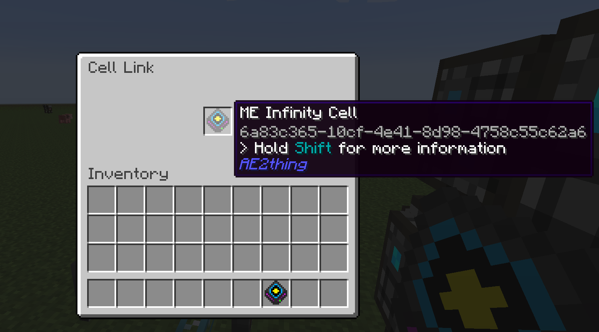
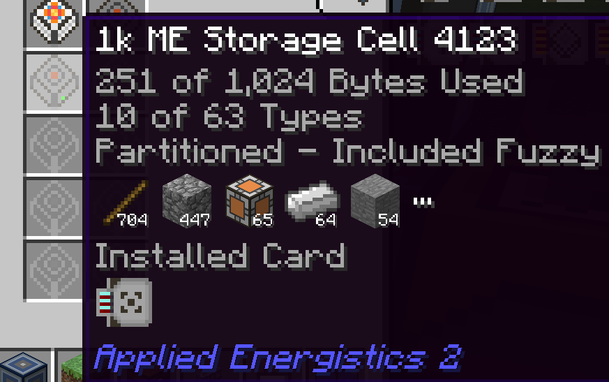

---
item_ids:
  - ae2thing:infinity_cell
  - ae2thing:infinity_fluid_cell
  - ae2thing:infinity_universal_cell
  - ae2thing:infinity_essentia_cell
  - ae2thing:creative_cell.cobblestone
  - ae2thing:creative_fluid_cell.water
  - ae2thing:creative_fluid_cell.lava
navigation:
  title: Storage
  parent: guide.md
  position: 90
  icon: ae2thing:infinity_cell
categories:
  - ae2things
author: vcwdfca
date: 2026-11-27
updated: 2026-11-27
---

# Storage

AE2Things adds three functional **Infinity Cells** and one crafting component. They are aimed at players who are tired of adding more 64k cells to a drive.

<Column>
  <Row>
    <ItemImage id="ae2thing:infinity_cell" scale="4" />
    <ItemImage id="ae2thing:infinity_fluid_cell" scale="4" />
    <ItemImage id="ae2thing:infinity_universal_cell" scale="4" />
    <ItemImage id="ae2thing:infinity_essentia_cell" scale="4" />
    <ItemImage id="ae2thing:creative_cell.cobblestone" scale="4" />
  </Row>
</Column>

Infinity Cells go into an <ItemLink id="appliedenergistics2:tile.BlockDrive" showIcon="left" /> or <ItemLink id="appliedenergistics2:tile.BlockChest" showIcon="left" /> like any other storage cell. The universal variant is the one to build when you want one cell for several resource types.

## Infinity Cells at a glance

| Cell | Stores | Upgrade slots | Idle drain |
| --- | --- | ---: | ---: |
| <ItemImage id="ae2thing:infinity_cell" label="right" /> | Items | 2 | 2,000 AE/t |
| <ItemImage id="ae2thing:infinity_fluid_cell" label="right" /> | Fluids (requires AE2FC) | 0 | 2,000 AE/t |
| <ItemImage id="ae2thing:infinity_universal_cell" label="right" /> | All registered AE stack types | 2 | See below |

The universal cell covers items, fluids, essentia, mana and any other stack type registered by another mod. Each type needs its provider installed: AE2FC for fluids, Thaumic Energistics for essentia, Applied Botanics for mana.

### What "infinite" means

- The cells have no practical item or type limit. You do not need to partition them just to make room for new types.
- They still respect their config slots: partitioning, fuzzy, inverter and sticky mode work normally.
- A cell cannot store another storage cell that already contains data.
- Contents are saved world-side and tied to the cell's UUID. The item is effectively a key, so keep a backup of valuable cells.
- Power is the real limit. The item and fluid cells use 2,000 AE/t each. The universal cell is a multi-type cell, so check the drive's actual idle power.

The Item and Universal cells have two upgrade slots. Capacity Cards do not increase the already-unlimited storage.

### The essentia component

<ItemImage id="ae2thing:infinity_essentia_cell" label="right" />

The **ME Infinity Essentia Cell** is a crafting component for the universal cell in 29x, not a standalone storage cell. It requires Thaumic Energistics. Once the universal cell is built, it can store essentia along with the other registered types.

## Linking cells

Every Infinity storage cell has a UUID. Linking makes several cells point at the same UUID, so they share one storage.

1. Right-click a storage cell to open the **Cell Link** screen. `cellLink` must be enabled in the config.
2. Put another cell of the **same variant** into the link slot. It must be empty, have no UUID, or already carry the same UUID.
3. The linked cell now shows the original cell's contents.
4. To break the link, sneak and right-click the linked cell. This wipes its NBT (link, filter and upgrades) and leaves an empty cell. The old UUID's world-side contents are not deleted, but this cell no longer points at them.

> [!WARNING]
> Linking is not a backup. If every cell with one UUID is lost, that storage can no longer be reached from the item side. Linking many cells to one hot storage also adds load, so do not use it as a mass-storage trick on a busy server.

## Recipes

<Column>
  <Row>
    <RecipeFor id="ae2thing:infinity_cell" />
    <RecipeFor id="ae2thing:infinity_fluid_cell" fallbackText="Requires AE2FC singularity cells." />
  </Row>
  <Row>
    <RecipeFor id="ae2thing:infinity_essentia_cell" fallbackText="Requires Thaumic Energistics' singularity cell." />
    <RecipeFor id="ae2thing:infinity_universal_cell" fallbackText="The universal cell requires the item and fluid cells, plus the essentia component when Thaumic Energistics is installed." />
  </Row>
</Column>

## Creative cells

<ItemGrid>
  <ItemIcon id="ae2thing:creative_cell.cobblestone" />
  <ItemIcon id="ae2thing:creative_fluid_cell.water" />
  <ItemIcon id="ae2thing:creative_fluid_cell.lava" />
</ItemGrid>

The creative cells provide an endless supply of cobblestone, water or lava. Each one has a single type and behaves as an infinite source. Item and fluid creative cells use 2,000 AE/t, like the single-type Infinity Cells. Inserting into them does not accumulate anything.

The cobblestone and water variants have crafting recipes in the base mod; the lava variant and pack-specific versions may be creative-only or pack-gated. Check NEI before planning a survival build around them.

## Reading cell contents

Hold <kbd>Shift</kbd> over a cell to expand its tooltip. It reports the stored amount and types; fluid and universal cells list each supported type. With NEI installed, the usage key opens the full contents view for supported cells.

