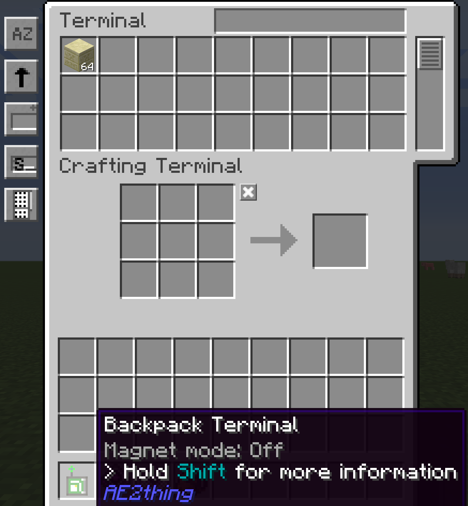
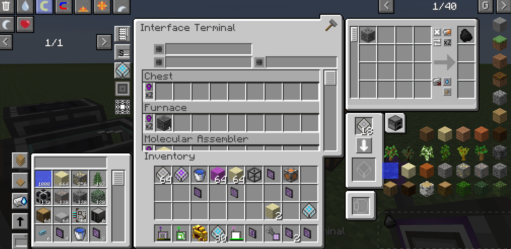

---
item_ids:
  - ae2thing:backpack_terminal
  - ae2thing:wireless_dual_interface_terminal
navigation:
  title: Terminals
  parent: guide.md
  position: 80
  icon: ae2thing:backpack_terminal
categories:
  - ae2things
author: vcwdfca
date: 2026-11-27
updated: 2026-11-27
---

# Terminals

This module covers the two large terminals and the quality-of-life features AE2Things adds to ordinary AE2 terminals.

<Column>
  <Row>
    <ItemImage id="ae2thing:backpack_terminal" scale="4" />
    <ItemImage id="ae2thing:wireless_dual_interface_terminal" scale="4" />
  </Row>
</Column>

## Backpack Terminal

<ItemImage id="ae2thing:backpack_terminal" label="right" />

The Backpack Terminal exposes a wearable backpack as an ME-style terminal.



- Right-click to open it, or bind **Open Backpack Terminal** in Controls.
- Supported backpacks: the Backpack mod, Adventure Backpacks, Forestry backpacks and OKBackpack.
- It shows the backpack inventory and a crafting grid, so you can work from backpack contents directly.
- It can be equipped in a Baubles slot when `terminalBaubles` is enabled.
- Tinkers' Construct tool modification is optional and controlled by `backpackTerminalAddTicSupport`.

### Magnet modes

Sneak and right-click the terminal to cycle:

| Mode | Behaviour |
| --- | --- |
| Off | No pickup. |
| Pickup to inventory | Pulls drops toward the player and collects them normally. |
| Pickup to backpack | Sends drops straight into the backpack inventory. |

The range is set by `magnetRange` (default 32 blocks). The magnet also collects nearby experience orbs.

<RecipeFor id="ae2thing:backpack_terminal" />

## Wireless Dual Interface Terminal

<ItemImage id="ae2thing:wireless_dual_interface_terminal" label="right" />



One item combines two tools:

- an **interface terminal** that lists interfaces on the current ME network and lets you inspect or edit their patterns remotely;
- a **pattern terminal** with crafting and processing pattern encoding.

It follows normal AE2 wireless terminal rules: link it to a network, keep it powered, and use an Infinity Booster Card for unlimited range. It fits a Baubles slot when `terminalBaubles` is enabled. Its keybind is unbound by default; set **Open Dual Interface Terminal**, or use the terminal menu below.

### Pattern pages

| Setting | Value |
| --- | --- |
| Pages | `multiPagesSupport`, 2–64 |
| Input slots per page | 16 |
| Output slots per page | 4 |
| Inverted mode | Swaps input and output capacities |

Lowering the page count can leave extra pages on existing patterns, so only reduce it when those recipes are no longer needed.

### Auto upload

Auto upload is exclusive to this terminal. Enable it under **NEI Options → AE2 Thing → Dual Interface Terminal**.

- With **Auto upload pattern** on, an NEI recipe transfer encodes and uploads the pattern when exactly one interface can run the recipe.
- If several interfaces match, the first match is highlighted. <kbd>Alt</kbd> + click the encode button uploads to it; <kbd>Alt</kbd> + scroll over the button cycles the target.
- The terminal reports no blank pattern, an occupied slot or a duplicate pattern in chat instead of failing silently.

### Enhanced search

If the default target selection picks the wrong interface, enable **Enhanced recipe search**. Start the query with `@`, then the recipe pool name, page title, category or id, followed by filters. Plain numbers match whole values; prefix a term with `-` to exclude it.

```text
@gt.recipe.centrifuge
@gt.recipe.centrifuge -mv
```

The search only works while the NEI option is enabled. The debug option prints the resolved pool and per-interface results to the client log.

<RecipeFor id="ae2thing:wireless_dual_interface_terminal" fallbackText="Requires AE2FC wireless terminals." />

## Terminal menu

The **Open Terminal Menu** keybind lists supported wireless terminals in your inventory and Baubles slots. It covers AE2FC ultra and base terminals, the Dual Interface Terminal, wireless crafting terminals and the Backpack Terminal. Use it when several terminals share one open key or when a terminal is equipped rather than held.

## Native terminal quality of life

These features enhance ordinary AE2 terminals; they do not replace them.

| Feature | What it does |
| --- | --- |
| Enhanced pins | Pin items or crafting jobs. <kbd>Alt</kbd> + click switches modes; <kbd>Ctrl</kbd> + click changes rows. |
| Player pin layout | Fixed or scrolling (`scrollPlayerPins`). |
| Crafting pin order | Auto, FIFO or LRU. |
| Quick order | Middle-click NEI items to order from AE. |
| NEI auto crafting | Use NEI auto crafting in AE terminals. |
| History and status | Show recent history, inventory and crafting state. |
| Pinned crafting bar | Track jobs; optionally remove finished ones. |
| Crafting tree and replan | Show the tree or replan. Unavailable in lite crafting mode. |
| Pattern item rename | <kbd>Ctrl</kbd> + middle-click edits an item name inside a pattern. |

With modern interaction enabled, <kbd>Ctrl</kbd> + left-click toggles an item pin, <kbd>Ctrl</kbd> + <kbd>Shift</kbd> + left-click stores and pins, and <kbd>Shift</kbd> + right-click unpins.

## Modern container interaction

When `modernInteraction` is enabled, clicking a fluid, essentia or mana container in a terminal fills or drains it directly from network storage, without holding the usual container key. It works with cells, tanks, phials and Botania mana containers.

If the held item is empty or the filled result needs a container, the terminal can retrieve a suitable empty container from the ME network. `defaultContainers` maps a stack type to a preferred empty item, for example `fluid=IC2:itemCellEmpty@0`; repeat entries for the same type to try several containers in order.
