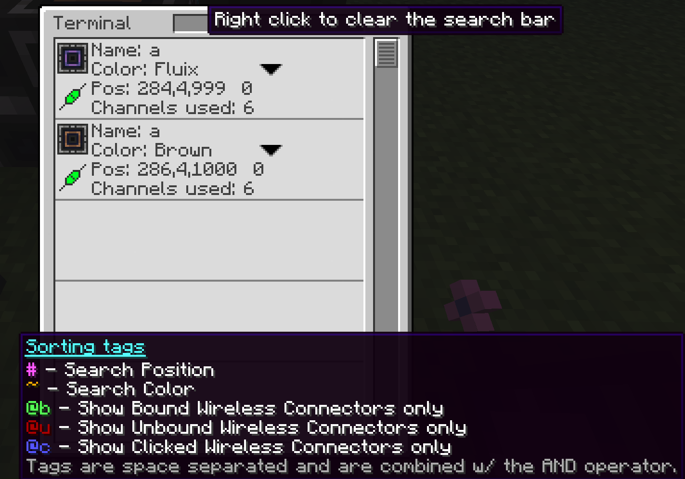
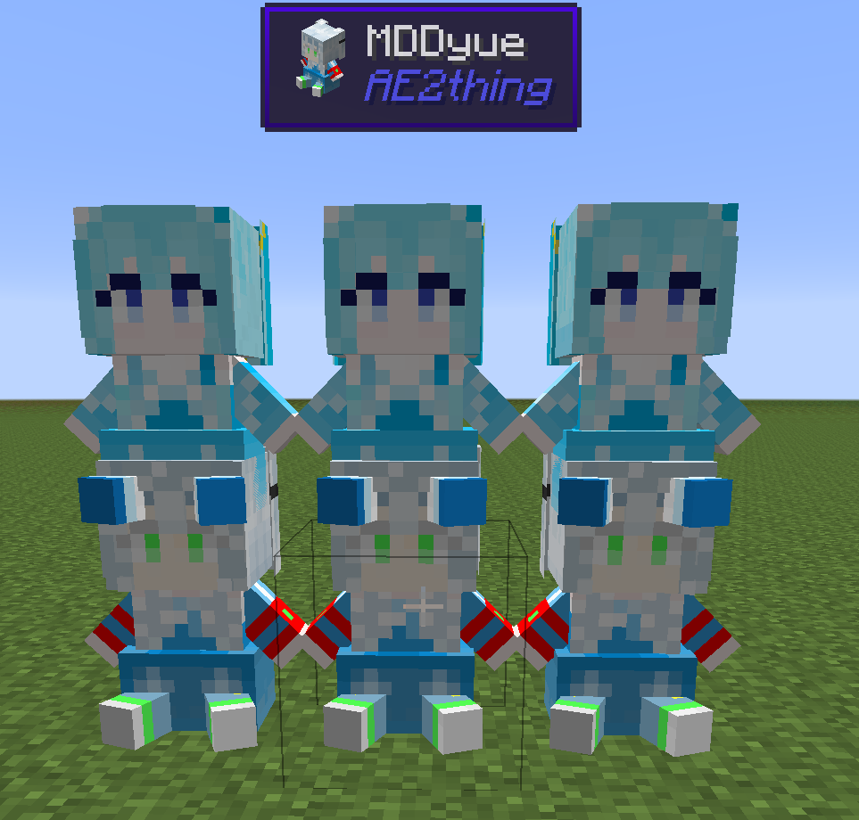

---
item_ids:
  - ae2thing:wireless_connector_terminal
  - ae2thing:part_wireless_connector_terminal
  - ae2thing:pattern_modifier
  - ae2thing:crafting_debug_card
navigation:
  title: Wireless & Tools
  parent: guide.md
  position: 60
  icon: ae2thing:wireless_connector_terminal
categories:
  - ae2things
author: vcwdfca
date: 2026-11-27
updated: 2026-11-27
---

# Wireless and Tools

Three utilities for connector management, pattern editing and crafting diagnostics.

<Column>
  <Row>
    <ItemImage id="ae2thing:wireless_connector_terminal" scale="4" />
    <ItemImage id="ae2thing:part_wireless_connector_terminal" scale="4" />
    <ItemImage id="ae2thing:pattern_modifier" scale="4" />
    <ItemImage id="ae2thing:crafting_debug_card" scale="4" />
  </Row>
</Column>

## Wireless Connector Terminal

<Row>
  <ItemImage id="ae2thing:wireless_connector_terminal" label="right" />
  <ItemImage id="ae2thing:part_wireless_connector_terminal" label="right" />
</Row>

The portable item and the cable part open the same interface for **AE2Stuff** wireless connectors. It lists connectors on the current network and on other networks owned by the same player.

| Action | Effect |
| --- | --- |
| Bind | Links a pair of connectors; existing links on either side are replaced. |
| Unbind | Breaks the selected connector's link. |
| Name | Sets a custom name. |
| Color | Changes the AE color. |
| Channels used | Shows the channels the link currently consumes. |
| Highlight | Highlights the connector in the world; cross-dimension targets report their dimension. |

The terminal's connection range is unlimited by default, controlled by `wirelessConnectorTerminalInfinityConnectionRange`. AE2Stuff is optional for the rest of AE2Things, but the terminal needs it to manage connectors.

<RecipeFor id="ae2thing:wireless_connector_terminal" fallbackText="Requires AE2Stuff." />

## Pattern Modifier

<ItemImage id="ae2thing:pattern_modifier" label="right" />

A portable pattern workshop with 36 pattern slots.

### Move patterns into or out of an interface

Sneak and right-click an AE interface, or a supported GT interface, to transfer patterns.

- **Insert only** fills empty interface slots from the modifier.
- **Swap** exchanges the modifier's patterns with the interface slots, which is useful for rotating a recipe set.
- Sneak and right-click the air to switch modes.

### Rewrite patterns in bulk

Put a source and a target stack into the replace slots, then use **Replace**. Every pattern in the modifier has matching inputs or outputs replaced. **Clear** returns the patterns to blank patterns.

The replace function preserves pattern type and skips patterns that would become empty. It reports skipped patterns and reports when nothing matched. It is useful for changing an ingredient across a whole interface.

<RecipeFor id="ae2thing:pattern_modifier" />

## Crafting Debug Card

<ItemImage id="ae2thing:crafting_debug_card" label="right" />

Prints a network's recent crafting history to chat. Right-click an **ME Controller** to read its network. Sneak and right-click the air to cycle the request filter:

| Mode | Shows |
| --- | --- |
| Everything | All requests. |
| Machine | Requests from machines and interfaces. |
| Player | Requests started by players. |

Each entry includes the request type, network id, source position when relevant, item name and size, start time, state, simulation time and any error message. History size is controlled by `craftingHistorySize` (default 200, range 100–300). This is a diagnostic tool, not a replacement for the crafting monitor.

<RecipeFor id="ae2thing:crafting_debug_card" />

## Decorative blocks

**FishBig** and **MDDyue** are decorative doll blocks with no network function. FishBig is crafted from fish and MDDyue from eggs.

