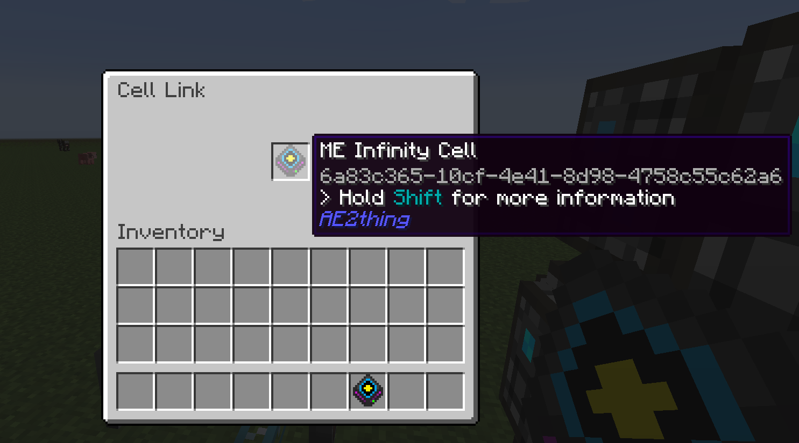
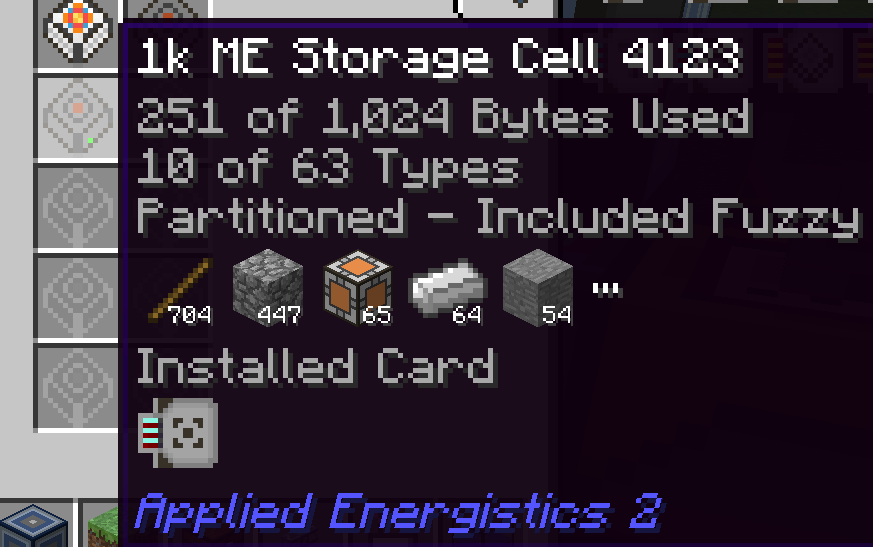

---
item_ids:
  - ae2thing:infinity_cell
  - ae2thing:infinity_fluid_cell
  - ae2thing:infinity_universal_cell
  - ae2thing:infinity_essentia_cell
  - ae2thing:creative_cell.cobblestone
  - ae2thing:creative_fluid_cell.water
  - ae2thing:creative_fluid_cell.lava
navigation:
  title: 存储
  parent: guide.md
  position: 90
  icon: ae2thing:infinity_cell
categories:
  - ae2things
author: vcwdfca
date: 2026-11-27
updated: 2026-11-27
---

# 存储

AE2Things 增加了三种可用的**无限存储单元**和一个合成组件，适合不想继续往驱动器里塞 64k 元件的玩家。

<Column>
  <Row>
    <ItemImage id="ae2thing:infinity_cell" scale="4" />
    <ItemImage id="ae2thing:infinity_fluid_cell" scale="4" />
    <ItemImage id="ae2thing:infinity_universal_cell" scale="4" />
    <ItemImage id="ae2thing:infinity_essentia_cell" scale="4" />
    <ItemImage id="ae2thing:creative_cell.cobblestone" scale="4" />
  </Row>
</Column>

无限存储单元和其他存储元件一样，放入 <ItemLink id="appliedenergistics2:tile.BlockDrive" showIcon="left" /> 或 <ItemLink id="appliedenergistics2:tile.BlockChest" showIcon="left" /> 即可使用。需要同时存储多种资源时，优先制作通用单元。

## 无限存储单元一览

| 单元 | 存储内容 | 升级槽 | 空闲耗能 |
| --- | --- | ---: | ---: |
| <ItemImage id="ae2thing:infinity_cell" label="right" /> | 物品 | 2 | 2,000 AE/t |
| <ItemImage id="ae2thing:infinity_fluid_cell" label="right" /> | 流体（需要 AE2FC） | 0 | 2,000 AE/t |
| <ItemImage id="ae2thing:infinity_universal_cell" label="right" /> | 所有已注册的 AE 堆栈类型 | 2 | 见下文 |

通用单元可以存储物品、流体、源质、魔力以及其他模组注册的类型。每种类型都需要对应的提供者：流体需要 AE2FC，源质需要神秘能源学，魔力需要应用植物学。

### “无限”的含义

- 单元没有实际的数量和类型上限，不需要为了容纳新类型而分区。
- 仍然遵守配置槽：分区、模糊、反相和粘性模式都正常生效。
- 不能存储已经装有内容的存储元件。
- 内容保存在世界存档中，通过单元 UUID 关联。物品相当于钥匙，请为贵重单元做好备份。
- 真正的限制是电力。物品型和流体型单元每个消耗 2,000 AE/t；通用单元属于多类型单元，请以驱动器实际空闲耗电为准。

物品型和通用型单元有 2 个升级槽。容量卡不会增加原本就无限的容量。

### 源质组件

<ItemImage id="ae2thing:infinity_essentia_cell" label="right" />

**ME无限源质存储单元**在 29x 中是通用单元的合成组件，不是独立存储单元。它需要神秘能源学。做出通用单元后，通用单元才能和其他已注册类型一起存储源质。

## 链接元件

每个无限存储单元都有一个 UUID。链接可以让多个单元指向同一个 UUID，共享同一份存储。

1. 右击存储单元，打开 **元件链接** 界面。配置项 `cellLink` 必须启用。
2. 在链接槽中放入另一个**同类型**单元。目标必须是空单元、没有 UUID，或已经带有相同 UUID。
3. 链接后的单元会显示原单元的内容。
4. 需要解除链接时，潜行右击已链接的单元。这会清空它的 NBT（链接、过滤和升级），留下一个空单元。旧 UUID 在世界存档中的内容不会被删除，但这个单元不再指向它们。

> [!WARNING]
> 链接不是备份。如果同一个 UUID 的所有单元都丢失，就无法再从物品侧访问这份存储。把大量单元链接到同一份高频访问的存储也会增加负担，不要在繁忙服务器上把它当作批量存储来滥用。

## 配方

<Column>
  <Row>
    <RecipeFor id="ae2thing:infinity_cell" />
    <RecipeFor id="ae2thing:infinity_fluid_cell" fallbackText="需要 AE2FC 的奇点元件。" />
  </Row>
  <Row>
    <RecipeFor id="ae2thing:infinity_essentia_cell" fallbackText="需要神秘能源学的奇点元件。" />
    <RecipeFor id="ae2thing:infinity_universal_cell" fallbackText="通用单元需要物品和流体单元；安装神秘能源学后还需要源质组件。" />
  </Row>
</Column>

## 创造元件

<ItemGrid>
  <ItemIcon id="ae2thing:creative_cell.cobblestone" />
  <ItemIcon id="ae2thing:creative_fluid_cell.water" />
  <ItemIcon id="ae2thing:creative_fluid_cell.lava" />
</ItemGrid>

创造元件分别提供无限的圆石、水或岩浆。每种只有一种类型，并作为无限来源。物品型和流体型创造元件与单类型无限单元一样消耗 2,000 AE/t；向其中注入不会累积任何东西。

圆石和水元件在基础模组中有合成配方；岩浆元件和整合包自定义版本可能是创造模式专用或由整合包配方控制。围绕它们规划生存流程前，请先查看 NEI。

## 查看元件内容

按住 <kbd>Shift</kbd> 查看元件提示，会展开已存数量和类型；流体单元和通用单元会按类型分别显示。安装 NEI 后，对支持的元件使用用途查询键可以打开完整内容视图。

