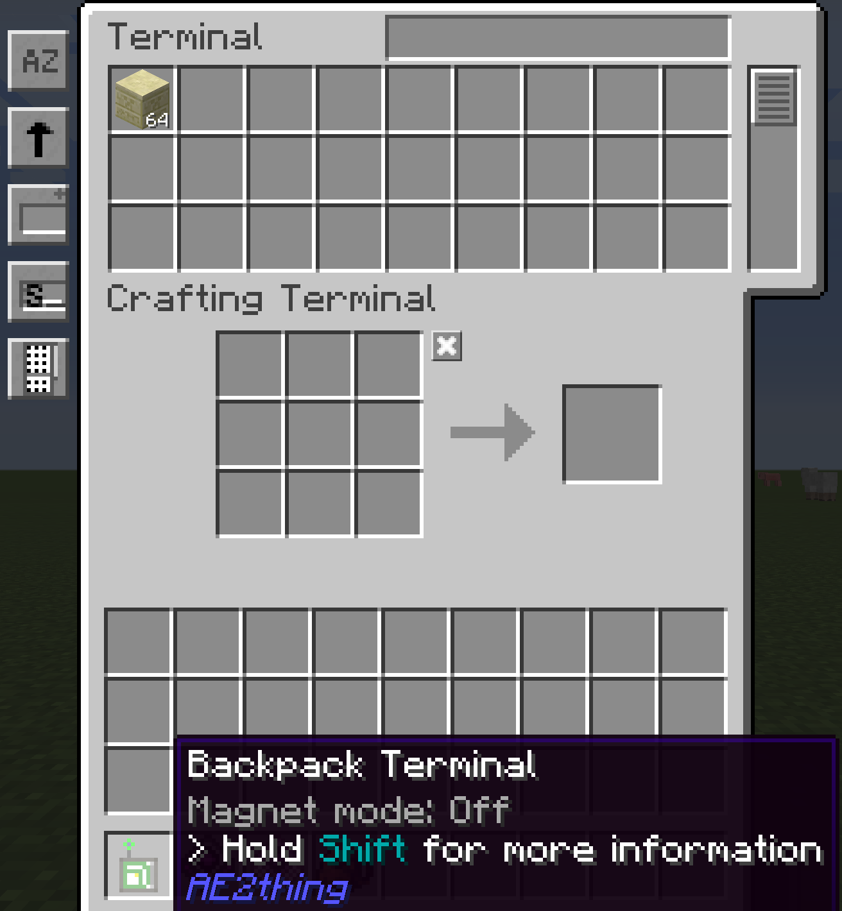
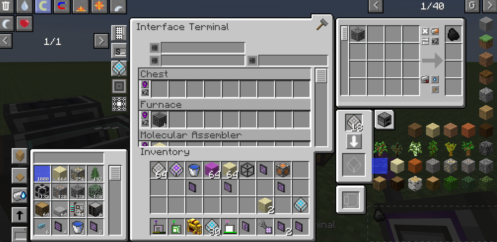

---
item_ids:
  - ae2thing:backpack_terminal
  - ae2thing:wireless_dual_interface_terminal
navigation:
  title: 终端
  parent: guide.md
  position: 80
  icon: ae2thing:backpack_terminal
categories:
  - ae2things
author: vcwdfca
date: 2026-11-27
updated: 2026-11-27
---

# 终端

本模块介绍两个大型终端，以及 AE2Things 为普通 AE2 终端增加的增强功能。

<Column>
  <Row>
    <ItemImage id="ae2thing:backpack_terminal" scale="4" />
    <ItemImage id="ae2thing:wireless_dual_interface_terminal" scale="4" />
  </Row>
</Column>

## 背包终端

<ItemImage id="ae2thing:backpack_terminal" label="right" />

背包终端把可穿戴背包接入为 ME 风格的终端。



- 右击打开，或在“控制”中为 **打开背包终端** 绑定按键。
- 支持的背包：Backpack 模组的背包、冒险背包、林业背包和 OKBackpack。
- 显示背包库存和一个合成格，可以直接用背包里的材料工作。
- 配置项 `terminalBaubles` 启用时，可以放进饰品栏。
- 允许加工匠魂工具是可选功能，由 `backpackTerminalAddTicSupport` 控制。

### 磁铁模式

潜行右击终端切换：

| 模式 | 行为 |
| --- | --- |
| 关闭 | 不拾取。 |
| 拾取到物品栏 | 把掉落物吸向玩家，按正常拾取处理。 |
| 拾取到背包 | 把掉落物直接塞进背包库存。 |

范围由 `magnetRange` 控制，默认 32 格。磁铁也会收集附近的经验球。

<RecipeFor id="ae2thing:backpack_terminal" />

## ME无线二合一接口终端

<ItemImage id="ae2thing:wireless_dual_interface_terminal" label="right" />



一件物品合并了两种工具：

- **接口终端**：列出当前 ME 网络上的接口，可以远程查看或编辑其中的样板；
- **样板终端**：支持合成样板和加工样板编码。

它遵循 AE2 无线终端的通用规则：先与网络绑定，保持供电；需要无限距离时安装无限增幅卡。配置项 `terminalBaubles` 启用时，可以放进饰品栏。按键默认未绑定，请设置 **打开二合一接口终端**，或使用下面的终端菜单。

### 样板页

| 设置 | 数值 |
| --- | --- |
| 页数 | `multiPagesSupport`，2–64 |
| 每页输入槽 | 16 |
| 每页输出槽 | 4 |
| 反转模式 | 交换输入和输出容量 |

调低页数后，已存在的样板可能仍会保留额外页面；只有在不再需要那些配方时才建议调低。

### 自动上传样板

自动上传仅限该终端。在 **NEI 设置 → AE2 Thing → 二合一接口终端** 中开启。

- 开启 **自动上传样板** 后，从 NEI 转移配方时，如果恰好只有一个接口能运行该配方，终端会自动编码并上传样板。
- 如果有多个接口匹配，终端会高亮第一个匹配项。按住 <kbd>Alt</kbd> 点击编码按钮，可上传到高亮接口；在按钮上 <kbd>Alt</kbd> + 滚轮可切换目标。
- 如果没有空白样板、目标槽已被占用或目标接口已有相同样板，终端会在聊天栏说明原因，而不是静默失败。

### 增强搜索

如果默认目标选择不准确，可以开启 **增强配方搜索**。查询以 `@` 开头，后接配方池名称、页面标题、配方分类或 id，再追加过滤词。纯数字按完整数值匹配；词前加 `-` 表示排除。

```text
@gt.recipe.centrifuge
@gt.recipe.centrifuge -mv
```

该搜索只在 NEI 选项开启时生效。调试选项会把解析到的配方池和每个接口的匹配结果打印到客户端日志。

<RecipeFor id="ae2thing:wireless_dual_interface_terminal" fallbackText="需要 AE2FC 的无线终端。" />

## 终端菜单

按键 **打开选择终端菜单** 会列出玩家物品栏和饰品栏中受支持的无线终端，包括 AE2FC 超级终端和基础终端、ME无线二合一接口终端、无线合成终端以及背包终端。多个终端共用同一个打开键，或终端放在饰品栏里时，这个菜单尤其方便。

## 原生终端增强

这些功能增强普通 AE2 终端，而不是替换它们。

| 功能 | 作用 |
| --- | --- |
| 增强置顶 | 固定物品或合成任务。按 <kbd>Alt</kbd> + 点击切换模式；按 <kbd>Ctrl</kbd> + 点击改变行数。 |
| 玩家置顶布局 | 固定或随库存滚动（`scrollPlayerPins`）。 |
| 合成置顶顺序 | 自动、先进先出（FIFO）或最近最少使用（LRU）。 |
| 快速下单 | 中键点击 NEI 物品，从 AE 终端下单。 |
| NEI 自动合成 | 在 AE 终端内使用 NEI 自动合成。 |
| 历史与状态 | 显示最近历史、库存状态和合成状态。 |
| 合成固定栏 | 跟踪合成任务，可选择自动移除已完成任务。 |
| 合成树与重新规划 | 显示合成树或重新规划；精简合成模式下不可用。 |
| 样板物品重命名 | 按 <kbd>Ctrl</kbd> + 中键编辑样板中物品的名称。 |

开启现代交互后，<kbd>Ctrl</kbd> + 左键切换物品置顶，<kbd>Ctrl</kbd> + <kbd>Shift</kbd> + 左键存入并置顶，<kbd>Shift</kbd> + 右键取消置顶。

## 现代容器交互

配置项 `modernInteraction` 启用后，在终端中点击流体、源质或魔力容器，可以直接从网络存储填充或抽空，无需按住容器交互键。支持存储元件、储罐、源质瓶和植物魔法的魔力容器。

手持空容器，或填充结果需要容器时，终端可以从 ME 网络取回合适的空容器。`defaultContainers` 按堆栈类型指定默认空容器，例如 `fluid=IC2:itemCellEmpty@0`；同一类型可以重复填写多个条目，按顺序尝试。
