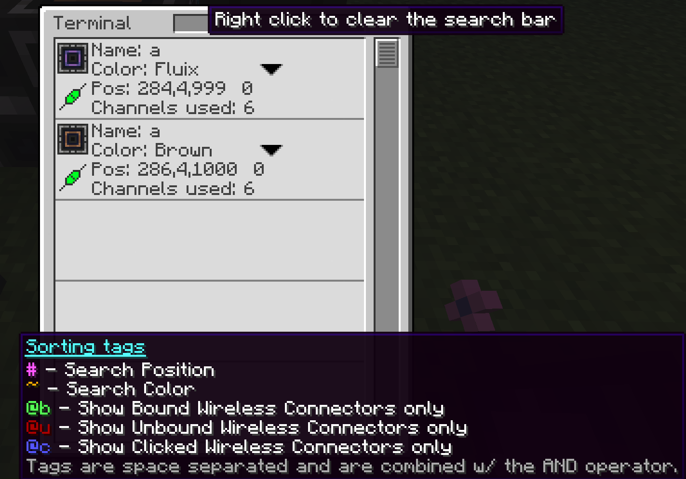
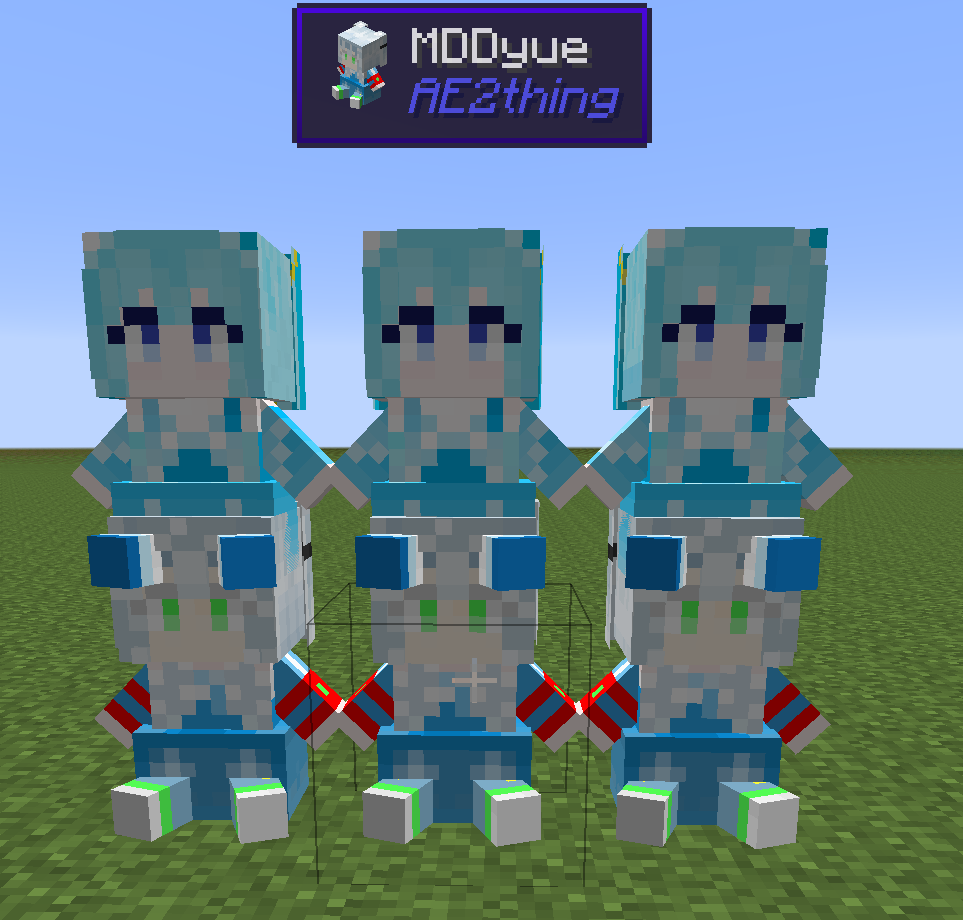

---
item_ids:
  - ae2thing:wireless_connector_terminal
  - ae2thing:part_wireless_connector_terminal
  - ae2thing:pattern_modifier
  - ae2thing:crafting_debug_card
navigation:
  title: 无线与工具
  parent: guide.md
  position: 60
  icon: ae2thing:wireless_connector_terminal
categories:
  - ae2things
author: vcwdfca
date: 2026-11-27
updated: 2026-11-27
---

# 无线与工具

三个实用工具：管理无线连接器、批量改写样板，以及排查合成任务。

<Column>
  <Row>
    <ItemImage id="ae2thing:wireless_connector_terminal" scale="4" />
    <ItemImage id="ae2thing:part_wireless_connector_terminal" scale="4" />
    <ItemImage id="ae2thing:pattern_modifier" scale="4" />
    <ItemImage id="ae2thing:crafting_debug_card" scale="4" />
  </Row>
</Column>

## ME无线连接终端

<Row>
  <ItemImage id="ae2thing:wireless_connector_terminal" label="right" />
  <ItemImage id="ae2thing:part_wireless_connector_terminal" label="right" />
</Row>

便携物品和线缆部件打开同一个界面，用于管理 **AE2Stuff** 的无线连接器。它会列出当前网络上的连接器，以及同一玩家拥有的其他网络上的连接器。

| 操作 | 作用 |
| --- | --- |
| 绑定 | 把一对连接器连起来；两端原有的链接会被替换。 |
| 解绑 | 断开选中连接器的链接。 |
| 名称 | 设置自定义名称。 |
| 颜色 | 修改 AE 颜色。 |
| 已使用频道 | 显示这条连接当前占用的频道数。 |
| 高亮 | 在世界中高亮连接器；跨维度目标会提示所在维度。 |

终端连接距离默认无限，由 `wirelessConnectorTerminalInfinityConnectionRange` 控制。AE2Things 的其他功能不强制依赖 AE2Stuff，但要管理连接器就必须安装它。

<RecipeFor id="ae2thing:wireless_connector_terminal" fallbackText="需要 AE2Stuff。" />

## 样板修改器

<ItemImage id="ae2thing:pattern_modifier" label="right" />

有 36 个样板槽的便携式样板工作台。

### 把样板放入或取出接口

潜行右击 AE 接口（或支持的 GT 接口）进行转移。

- **只放入**：把修改器里的样板填进接口空槽。
- **对调**：与接口槽位交换样板，适合轮换一整组配方。
- 潜行右击空气切换模式。

### 批量改写样板

在替换源和替换目标槽中放入物品，然后点 **替换**。修改器内所有样板中匹配的输入或输出都会被替换。点 **清除** 可以把样板还原成空白样板。

替换会保留样板类型，并跳过替换后会变成空白的样板。操作后会提示跳过了多少样板；如果一个都没匹配上，也会给出提示。适合在整个接口范围内统一更换某种原料。

<RecipeFor id="ae2thing:pattern_modifier" />

## 合成DEBUG卡

<ItemImage id="ae2thing:crafting_debug_card" label="right" />

把网络最近的合成历史打印到聊天栏。右击 **ME控制器** 读取该网络。潜行右击空气切换请求过滤：

| 模式 | 显示 |
| --- | --- |
| 所有 | 全部请求。 |
| 机器 | 来自机器和接口的请求。 |
| 玩家 | 玩家发起的请求。 |

每条记录包含请求类型、网络 id、来源坐标（如适用）、物品名称和数量、开始时间、状态、模拟耗时以及错误信息。历史条数由 `craftingHistorySize` 控制，默认 200，允许 100–300。它是排查工具，不替代合成监视器。

<RecipeFor id="ae2thing:crafting_debug_card" />

## 装饰方块

**鱼大（FishBig）** 和 **猫蛋蛋（MDDyue）** 是装饰玩偶方块，没有网络功能。鱼大由鱼合成，猫蛋蛋由鸡蛋合成。

